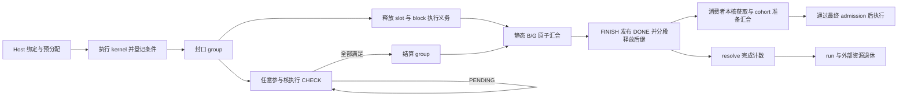

# A5 HBG AICore 异步完成开发方案

本方案为 A5 `host_build_graph` 的 AICore resident scheduler 定义 deferred completion。
业务 kernel 可以登记完成条件后返回，执行核继续处理其他工作；只有计算、异步条件和数据可见性要求全部满足，原逻辑 task 才发布完成并释放消费者。

本文档组规定待实现的目标行为和接口，不表示功能已经交付。适用环境为具有 native Graph、SPMD、GM MIX 和 ordered admission 的 A5 HBG；既有同步调度、通信域和 run 退休机制作为集成基础。

## 1. 功能范围

| 范围 | 开发目标 |
| ---- | -------- |
| 条件类型 | 通知 COUNTER、SDMA post-done；同一 group 可包含多类型、多资源条件 |
| 普通任务 | AIC/AIV 单 lane 任务；完成条件检查可由其他参与核执行 |
| 并行任务 | SPMD、MIX masks 3/5/6/7、`sync_start` |
| Graph | 当前单层 native Graph、多实例、内部与外部依赖、普通任务混排 |
| predicate | 保留单 lane、单 block 的原生支持边界；skip 不执行 kernel、不发起 DMA |
| 前端 | 原生 C++ 注册接口及 PyPTO `defer_wait` 自动能力/绑定传递 |
| 错误与关闭 | 注册和提交失败、非法条件、超时、核故障、pending 时 close、资源代次隔离 |

SDMA 的发起资格与条件的观察资格分开定义。提交使用经过验证的 backend 发起核；目标要求参与调度的 AIC/AIV 都能检查受支持条件，不把固定代理核作为完成此目标的替代方案。具体硬件操作必须通过[后端资格验证](a5-hbg-async-completion/backends-and-lifetime.md)。

不增加 kernel 抢占/恢复、隐式 continuation、嵌套 Graph、多 block/MIX predicate 或未经验证的 URMA/RDMA/CCU 原生完成事件。不增加正常路径的 AICPU 条件轮询，也不在执行过程中退回 legacy 或阻塞等待。

`defer_wait` 仅登记条件，不隐式 return。依赖异步结果的计算必须放在另一 task，通过真实依赖连接；PyPTO waiter 继续遵守其注册专用 kernel 限制。

## 2. 架构与执行流程

| 层级 | 职责 |
| ---- | ---- |
| 编译器与注册层 | 提供与 kernel 身份绑定的异步能力、条件容量及 writer ABI |
| Host bind | 展开 task/block/lane 映射，绑定资源及发布用途，生成消费者范围计划，预分配记录并持有资源 |
| backend adapter | 验证提交、预留条件槽、登记带资源身份的条件、提供有界观察及可见性操作 |
| AICore resident scheduler | 释放执行资源，领取 CHECK/FINISH，汇合完成，分段释放后继并推进消费者本核准备 |
| AICPU 与 run/domain owner | 既有启动、错误监督、核退出、外部访问确认和最终资源回收 |

每个声明异步能力的物理执行拥有一个 `AsyncGroup`，每个含此类执行的逻辑 task 拥有一个 `AsyncTaskFinish`。CHECK 和 FINISH 是控制工作，不创建业务 TaskId，不占 dispatch slot，也不取得 cooperative admission。

基础实现采用静态 group 责任计数、常驻完成记录、平坦活动位图、有界 strong-CAS 目录更新和统一 FINISH 路径。完成记录在 run 内不移动、不回收；消费准备状态随 slot generation 重新初始化。同步 task 保持既有完成路径，读取异步输出时仍执行本核准备。已证明整个 run 无异步能力且无额外消费获取要求时，不分配相关区域、不探测目录。

## 3. 完成语义与不变量

| 边界 | 必须成立的事实 | 尚不能据此执行的动作 |
| ---- | -------------- | -------------------- |
| KernelReturned | 调用结束，当前执行的登记封口 | 不能假定异步 payload 已可用 |
| ExecutionReleased | slot 及该执行的局部义务结束；MIX 按参与 lane 收尾 | 不能直接发布逻辑 TaskDone |
| TaskDone | 全部 block 已释放、全部 group 已结算、发布侧可见性合同成立 | 不能假定后继已全部路由或 run 可回收 |
| ResolveDrained | 后继路由、ready 发布及本 task 完成记账全部收敛 | 不能假定外部 DMA/peer 已停止访问 |
| RunRetired | 既有 run/核退休和关联外部访问证明成立 | 不能忽略其他 run/peer 的资源使用 |

消费者在读取 payload 前还必须完成其自身核需要的缓存获取操作；观察核的缓存维护不能代替消费者核。该要求独立于消费者的 `may_defer`，范围与数据版本由 Host 的消费计划给出；MIX/sync-start 在全部实际成员准备完成后才取得最终执行许可。

1. 一个物理执行只有一个登记写者，一个可服务记录同时只有一个 lease owner。
2. group 身份由 run、内部 task ref、block 和 subtask 确定，不依赖可复用 slot 或 DFX 数据。
3. 每个计划 group 都恰好结算一次，包含零登记与合法 skip；每个逻辑 block 都恰好释放一次。
4. 只有使汇合计数归零的原子递减者获得 FINISH 激活责任，读到零值的观察者不能再次激活。
5. TaskDone 恰好发布一次；run 完成计数晚于该 task 的全部后继发布和最后记录写入。
6. 每次服务有步骤预算，任何私有发布责任都不能跨越下一次业务 kernel。
7. cached 写回不得覆盖 atomic-only 控制行；跨核交权必须有实际 GM 发布/观察顺序。
8. 错误路径不补计数伪造成功，不用核 ACK 代替外部访问结束证明，不复用未知使用状态的资源。

## 4. 文档与实施入口

| 文档 | 唯一定义的内容 |
| ---- | -------------- |
| [接口与数据布局](a5-hbg-async-completion/interfaces-and-layout.md) | 能力描述、登记接口、资源绑定、记录身份、GM 布局和容量 |
| [调度与完成协议](a5-hbg-async-completion/protocol.md) | lease、目录、静态汇合、CHECK/FINISH、任务形状与服务预算 |
| [后端与资源生命周期](a5-hbg-async-completion/backends-and-lifetime.md) | SDMA/COUNTER、提交结果、数据可见性、复用和错误关闭 |
| [消费准备与准入](a5-hbg-async-completion/consumer-preparation.md) | payload 范围谱系、同步消费者、本核准备状态及 MIX/sync-start 汇合 |
| [实现方案](a5-hbg-async-completion/implementation.md) | 模块接线、依赖顺序、兼容迁移、错误与 DFX 集成 |
| [验证与性能验收](a5-hbg-async-completion/validation.md) | 功能矩阵、负对照、硬件资格、性能方法与交付条件 |
| [待验证选型](a5-hbg-async-completion/choices.md) | 替代实现、验证问题、选择条件及允许改变的合同 |

开发以基础设计建立完整 COUNTER/SDMA 闭环，再扩展全部任务形状和错误关闭，最后逐项比较优化候选。候选的优势必须在相同语义下验证；改变支持范围或错误合同不能作为无说明的性能优化。

各子文档只定义其负责的合同，其他文档通过链接引用。实施结果按验证文档的要求保存为测试产物，采用的接口和协议始终在对应设计文档中保持一致。
