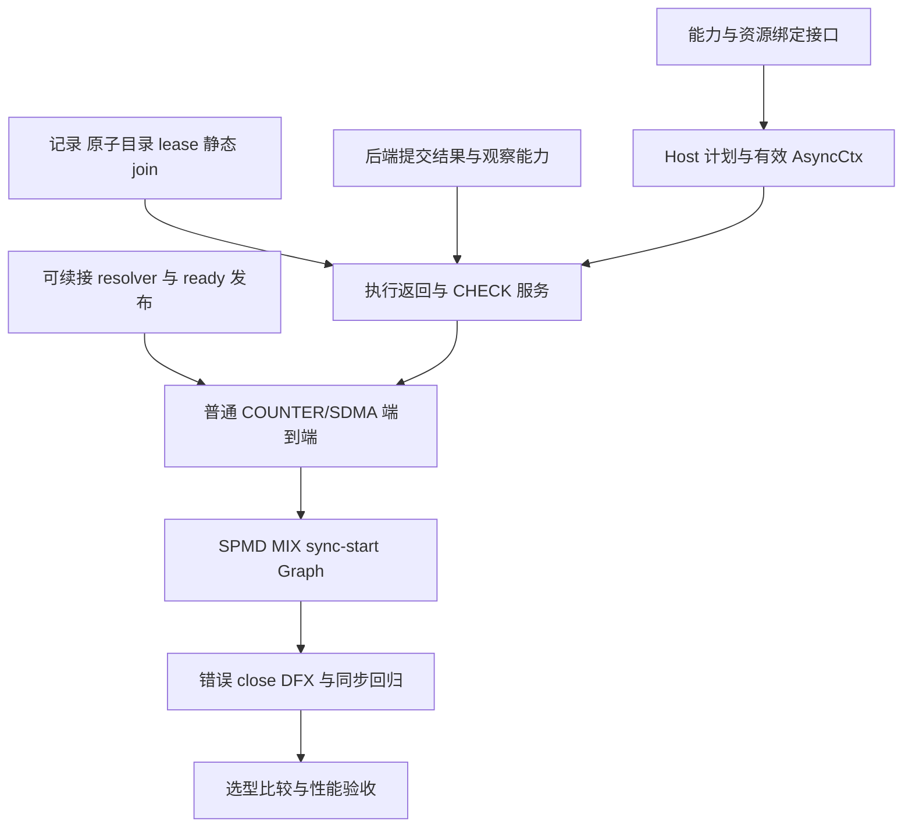

# A5 HBG 异步完成实现方案

[返回总览](../a5-hbg-async-completion.md)。本文规定代码接线、实施依赖和模块验收，接口、协议及后端语义分别以相应文档为准。模块名称和目标产物描述实现要求，不表示已完成状态。

## 1. 模块划分与接线

| 模块 | 代码入口 | 实现责任 |
| ---- | -------- | -------- |
| capability 与注册附属数据 | `src/common/task_interface/`、`python/bindings/`、`python/simpler/callable_identity.py` | 定义版本化能力描述；随 callable 复制、序列化、身份和缓存传递 |
| 编译与生成器接入 | `simpler_setup/kernel_compiler.py`、PyPTO 编译器与 runner | 为每个产物提供 writer ABI 和可信条件上界；自动传递窗口参数绑定 |
| Host 异步计划 | A5 HBG `host/runtime_maker.cpp`、`host/native_graph_plan.cpp` | 按实例展开 group；检查容量；构建绑定/UseSet；预分配并发布 image |
| kernel 登记 | `common/intrinsic.h`、`runtime/async_kernel_api.h`、`runtime/backend/sdma/` | 上下文版本、预留/commit、逐条件绑定、明确失败与封口 |
| 原语与记录 | `runtime/scheduler/scheduler_memory.h` 及异步记录/目录模块 | 实际原子/屏障、lease、静态 join、目录有界更新、类型布局检查 |
| 执行返回与服务 | `aicore/aicore_executor.cpp`、`scheduler_completion.h` | 封口、slot 释放、安全服务点、同步快速路径与错误传播 |
| cooperative 完成 | `scheduler_admission.h`、`scheduler_gm_mix.h`、`scheduler_dispatch.h` | 保留计算/admission 计数，单独贡献真实 B release，不提前 TaskDone |
| 后继路由 | `scheduler_ready.h`、`scheduler_graph_control.h` | 共用可续接 resolver、普通/control ready 发布、FINISH drain |
| 生命周期 | A5 HBG AICPU lifecycle、既有 run/domain/通信 owner | 保持监督职责，持有 UseSet，错误 close 与未知使用隔离 |
| 诊断 | scheduler protocol、Host 导出和 `simpler_setup/tools/hbg/` | 新事件语义、跨核身份、旧 schema 读取和有界错误报告 |

表中未带根路径的 runtime 文件均位于 `src/a5/runtime/host_build_graph/`。公共表示保持架构中立，A5 调度算法留在 A5 runtime；不为了复用 token 而同时改写 TMR/legacy 的完成算法。

## 2. Host、kernel 与 scheduler 的完整连接

### 编译到 bind

编译结果由二进制和 capability manifest 共同组成。manifest 绑定二进制身份、编译上下文及 writer ABI；修改任一组成部分都使相关缓存失效。原生编译调用提供异步声明，PyPTO 自动产生声明；生成器须为同步 kernel 产生明确的同步能力。

callable 注册读取并验证附属数据，Host 在 bind 时从当前 task 的实际 callable、参数和通信资源生成计划。多层 callable 的复制或 IPC 序列化不能丢失子 callable 的能力。允许旧 API 构建原始 callable 对象，不等于允许 UNKNOWN writer 进入新 resident 路径。

bind 按以下顺序执行：

1. 验证全部 callable 能力、任务形状和 backend 资格。
2. 展开普通任务及 Graph 实例的物理执行，生成唯一 group 映射、G0/B0 和 FINISH 映射。
3. 从实际参数/域 owner 取得资源身份、代次、合法区间和使用关系，持有静态 UseSet。
4. 计算完整 image 大小并检查预算；分配记录、sidecar、目录、映射和绑定表。
5. 初始化静态数据和控制字，完成既有 launch publication；发布失败保留对应 owner，按是否可能已有设备副作用处理。

无异步能力的 run 在能力验证后进入原同步布局。正常快路径不扫描异步目录，也不为每个同步执行增加 group 结算。

### dispatch 到返回

准备 dispatch payload 时，用稳定 task/block/subtask 映射定位 group，填入 resident AsyncCtx 和本执行的绑定视图；不能从 profiling/trace slot 推导 group 地址。业务 kernel 只写自己的登记区。

执行返回和合法 predicate skip 共用 runtime 尾部：保存稳定身份，检查并封口登记，发布非零 group 或结算零登记 group，完成参数/trace 发布，释放 slot 和局部义务，再在适当的单 lane/MIX 位置贡献 B。不得从已经复用的 payload、slot 或 UB 读取完成依据。

现有直接 TaskDone 分支按 task 能力分流：同步 task 仍走原路径，异步 task 只能通过 join 激活 FINISH。需要逐一覆盖普通、ordered、GM MIX 和 Graph child 的完成入口，不能只修改 executor 的最后一个分支。

### CHECK 到消费者

安全服务门先遵循已有完成/控制/发布责任，再按预算服务 CHECK 或 FINISH。CHECK 结束条件和可见性工作后结算 G；最后 join 递减者只发布 FINISH。FINISH 逐步路由后继，所有批次公开后才贡献 run 完成计数。

实际消费者的必要本核缓存获取在最终执行许可之前完成；若该获取需要分段，进度必须属于持久准备状态，不能持有 async lease 等待，也不能取得 cohort 许可后再执行可让出的异步工作。

## 3. 实施依赖与完成条件

| 工作包 | 必需产物 | 进入依赖工作的条件 |
| ------ | -------- | ------------------ |
| 能力/绑定合同 | schema、序列化、身份传递、参数到 binding 映射 | 未知 ABI、跨 run、越界、资源代次负例通过；无仅按地址猜测的绑定 |
| 原语与布局 | POD 布局、分配器、lease、目录、join | 真实 helper 的并发/边界测试通过，AIC/AIV 编译通过；全部上界有定义 |
| 后端能力 | 提交结果分类、公共记录映射、观察与缓存操作 | 实际 SDMA/COUNTER 的支持矩阵通过，非零提交异常不能成为零登记成功 |
| 普通闭环 | 有效上下文、返回封口、安全服务、FINISH | 真实事件晚于返回，独立任务推进，消费者及 payload 结果正确 |
| 全形状接线 | SPMD、全部 MIX masks、sync-start、Graph | group/block 唯一贡献，实例隔离、零登记/skip、容量边界全部通过 |
| 生命周期/诊断 | UseSet 持有、错误关闭、事件导出和工具读取 | 故障不提前释放，原始错误保留，旧诊断 schema 可读取 |
| 性能与兼容 | 同步回归、异步负载及候选对照 | 达到[验证要求](validation.md)，最终代码与采用的设计一致 |

工作包是同一功能内部的依赖，不把中间产物当作完整功能发布。后端观察验证、Host 绑定和通用 resolver 可以并行准备，但未经验证的接口不能由调用方假定成立。

## 4. 错误、DFX 与迁移

各 helper 返回明确的成功、未开始/可续接或错误结果。目录协议损坏、非法身份、计数错误不是普通 RETRY。失败一经被观察，调用者先锁存首错并持有相关资源，再进入既有错误收敛；清理失败不能覆盖原始错误。

DFX 使用新的协议版本区分以下事件：`registration_sealed`、`execution_released`、`condition_ready/failed`、`logical_done`、`resolve_drained`。身份包含 run、task/Graph、block/subtask、group、lease、观察 worker、条件类型和 binding generation。PENDING 合并为 span/次数，不在热路径逐次打印。

业务 task 数不包含 CHECK/FINISH 次数。跨核因果依靠发布/领取/完成关系重建，不仅靠不同核的时间戳排序。诊断开启与否不改变 group 映射、资源持有和协议正确性。

ArgsDump AFTER 必须在真实输出完成后、允许后继覆写之前封口。若该组合尚未接到正确边界，在 bind 前明确拒绝；不能在 kernel 返回时采集未完成 DMA 输出，也不能用最后一次输出覆盖代替逐 task 证据。

兼容迁移至少同时更新：编译产物 manifest、callable 附属数据、resident writer ABI、Host image/protocol 版本及诊断读取器。旧异步二进制不自动同步回退，旧诊断文件仍可读取。后端公共 ABI/pin 更新后重新验证对应 adapter 和硬件组合，不能只凭名称相同复用资格。

## 5. 开发完成定义

完整交付须同时满足总览范围、全部正常/错误协议及验证矩阵。还应具备可复现的构建与测试命令、精确产物身份、真实设备结果、性能原始样本和明确的支持矩阵；这些放入实现测试产物，而非混入接口定义。

常规实现按本方案推进。若实际能力要求缩小支持核集合、改变公开兼容性、放宽错误隔离或接受稳定性能退化，则先更新相应合同和选型结论，再进入依赖实现。不能靠未说明的 fallback、额外依赖边或放松测试判据获得通过。
